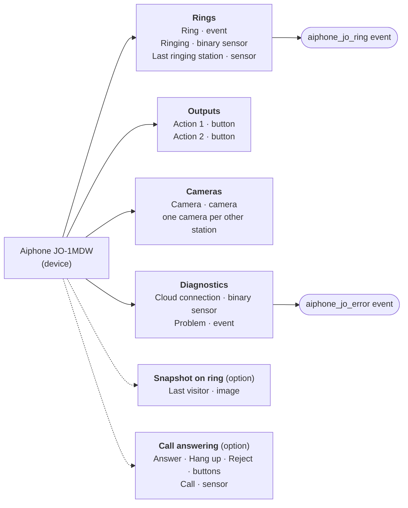
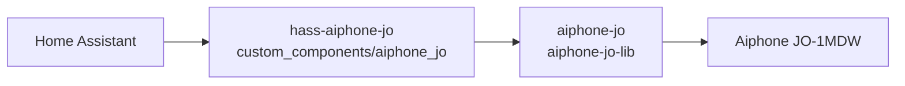

# Aiphone JO for Home Assistant

> [!WARNING]
> **Unofficial** project, not affiliated with Aiphone Co., Ltd. Read the
> [disclaimer](DISCLAIMER.md) before use.

Home Assistant integration for the **Aiphone JO-1MDW** video intercom,
installable through [HACS](https://hacs.xyz). It pairs with the monitor like
the official smartphone app, then works through the Aiphone cloud. It covers
rings, the monitor's two outputs (door, gate...), and a camera for each
entrance station with a live view. As options, it adds a picture of each
visitor and call answering.

## At a glance

Everything appears on one device, the monitor:

Each entity is described in [Entities](docs/entities.md).

## Status

- **Version 0.4**, approaching 1.0, used every day on real JO-1MDW
  installations.
- **JO-1MDW only**: the other monitors of the JO series are not supported.
- These work on real hardware:
  - ring detection;
  - the output buttons;
  - the cameras;
  - the snapshot on ring.
- **Call answering** and **talking to the visitor** are experimental options,
  disabled by default, and have not been validated on real hardware yet.

## Features

- **Rings**: a Ring event, a Ringing sensor, the last station that rang, and
  an `aiphone_jo_ring` event for automations and notifications.
- **Outputs**: the Action 1 and Action 2 buttons pulse the monitor's two
  outputs, which drive whatever is wired to them (door strike, gate motor,
  lighting...).
- **Cameras**: one per entrance station, with a still image and a WebRTC live
  view with sound, through go2rtc.
- **Snapshot on ring** (option): a picture of the visitor at each ring, taken
  without answering. It is kept across restarts.
- **Call answering** (experimental option): Answer, Hang up and Reject
  buttons and a Call sensor; talking to the visitor from the live view.
- **Problem reporting**: a Cloud connection sensor, repairs, a Problem entity,
  the `aiphone_jo_error` event, and redacted diagnostics.
- **Pairing and options**: local pairing with a pinned certificate, options
  that apply without a restart, and English and French translations.

## Requirements

- **Home Assistant**: 2025.1 or later.
- **go2rtc**, for the cameras:
  - on Home Assistant OS and Container, the go2rtc integration of the default
    configuration provides it;
  - on Home Assistant Core, use a go2rtc server, version 1.9.15 or later.
- **For pairing**:
  - Home Assistant and the monitor on the same local network, with UDP ports
    51711 and 51712 open;
  - a free smartphone slot on the monitor.
- **Internet access** for the monitor and Home Assistant (Aiphone cloud).

## Installation

**Through HACS** (custom repository):

1. HACS → ⋮ menu → **Custom repositories**.
2. Add `https://github.com/gclem/hass-aiphone-jo` with the **Integration**
   type.
3. Install **Aiphone JO**, then restart Home Assistant.

**Manually**: copy `custom_components/aiphone_jo` into the
`custom_components` folder of your Home Assistant configuration, then restart.

## Getting started

1. On the monitor, open the smartphone settings and start **adding a
   smartphone**.
2. In Home Assistant: **Settings → Devices & services → Add integration →
   Aiphone JO → Search the local network**.
3. Check the certificate fingerprint, enter the code shown on the monitor,
   and choose the terminal name.

Pairing details, troubleshooting and options are in the
[configuration guide](docs/configuration.md).

## Documentation

| Guide | Content |
|---|---|
| [Configuration](docs/configuration.md) | Pairing, troubleshooting, options, pairing again, removal |
| [Entities](docs/entities.md) | All the entities, the output buttons, availability |
| [Cameras](docs/cameras.md) | Live view, still images, one session at a time, go2rtc |
| [Rings and calls](docs/calls.md) | Ring event, snapshot on ring, call answering, talking to the visitor |
| [Problems and errors](docs/problems.md) | Cloud connection sensor, repairs, Problem entity, diagnostics |

## Known limitations

- **Cameras:**
  - The intercom runs **one monitoring session at a time**, so the cameras
    take turns.
  - Each image or live view may turn on the monitor screen or the station's
    light.
  - The live view pauses for a few seconds every minute, when the station
    renews its session.
- **Images:**
  - A new image takes several seconds, and Home Assistant gives up after 10
    seconds: the first image after a restart can fail once.
  - While a station rings, its camera only shows the last image, or the
    visitor's picture with the snapshot on ring.
- **Audio** comes from the station only, unless talking to the visitor
  (experimental) is enabled.
- **Outputs:** the intercom does not report their state; the buttons only
  send pulses.
- **Rings:** they go through the Aiphone cloud. Please report missed or
  delayed rings.
- **Removal:** removing the integration may leave the terminal in the
  monitor's smartphone list; delete it there.

## How it works

The project has two repositories:

| Repository | Role |
|---|---|
| [`gclem/aiphone-jo-lib`](https://github.com/gclem/aiphone-jo-lib) | Asyncio Python library, independent from Home Assistant, with the whole protocol (package `aiphone-jo`) |
| `gclem/hass-aiphone-jo` (this repository) | The Home Assistant integration, with no protocol logic of its own |

The integration ships its own copy of the library, updated with each library
release. The protocol is documented in the library's
[protocol reference](https://github.com/gclem/aiphone-jo-lib/blob/main/docs/PROTOCOL.md).

## Contributing

See [CONTRIBUTING.md](CONTRIBUTING.md) and the [changelog](CHANGELOG.md). To
report a vulnerability, see [SECURITY.md](SECURITY.md).

## License

[MIT](LICENSE).
