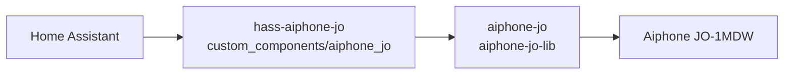

# Aiphone JO for Home Assistant

> [!WARNING]
> **Unofficial** project, not affiliated with Aiphone Co., Ltd. Read the
> [disclaimer](DISCLAIMER.md) before use.

Custom Home Assistant integration, installable through [HACS](https://hacs.xyz),
for the **Aiphone JO-1MDW** video intercom. Only this model is targeted; other
monitors of the JO series are not supported.

## Architecture

The project is split into two repositories:

| Repository | Role |
|---|---|
| [`gclem/aiphone-jo-lib`](https://github.com/gclem/aiphone-jo-lib) | Asyncio Python library, independent from Home Assistant, holding the whole protocol core (package `aiphone-jo`). |
| `gclem/hass-aiphone-jo` (this repository) | Home Assistant integration for the community and HACS. Contains no protocol logic of its own. |



The integration ships with its own copy of the library.

## Features

- **Ring** detection (call button pressed on an entrance station).
- **Action 1** and **Action 2** buttons, which trigger the monitor's two
  outputs.
- **Camera**: still image of an entrance station, refreshed while it is
  displayed, and a WebRTC live view with sound, through go2rtc.

See the [roadmap](ROADMAP.md) for upcoming features.

## Entities

All entities belong to one device, the monitor.

| Platform | Entity | Description |
|---|---|---|
| `event` | Ring | Doorbell event fired on each call, with the `station` that rang and its `raw_name`. |
| `binary_sensor` | Ringing | On while a station is calling; off when the call is answered elsewhere, cancelled, or after 60 seconds. |
| `sensor` | Last ringing station | Name of the station that rang last (kept across restarts), with `rang_at` and `raw_name`. |
| `button` | Action 1 | Pulses output 1 of the monitor (unlock output). |
| `button` | Action 2 | Pulses output 2 of the monitor (option output). |
| `camera` | Camera | Image and live view of the entrance station chosen in the options. |
| `image` | Last visitor | Image captured at the last ring, with `station` and `ringing_at` (only with the snapshot on ring option). |

What each output does depends on your installation: a door strike, a gate
motor, lighting or any other equipment wired to it. Rename the buttons in Home
Assistant to match it.

The buttons send **pulses**: they are not locks or switches, and the intercom
does not report any state for its outputs. The monitor only accepts output
commands during a short monitoring session: the integration opens one on an
entrance station, sends the command and closes it immediately. One session
runs at a time, so successive presses are queued. If the station is busy (call
or monitoring in progress), the other camera stations are tried.

### Camera

The camera shows the entrance station chosen in the options. It relies on
[go2rtc](https://github.com/AlexxIT/go2rtc), which Home Assistant runs itself
on Home Assistant OS and Container installations (go2rtc integration, part of
the default configuration). On a Home Assistant Core installation, or to use
another go2rtc server (1.9.15 or later), enter its URL in the options.

- **Live view** (WebRTC, video and sound): opening the camera starts a
  monitoring session on the entrance station. The station ends each session
  after **about 60 seconds**; while the live view is open, a new session is
  opened each time and the live view continues after an interruption of a few
  seconds. Several viewers share the same sessions, which stop a few seconds
  after the last viewer closes the live view.
- **Still image**: refreshed only while it is displayed (for example on a
  dashboard card), at most once per refresh interval (30 seconds by default,
  configurable from 10 to 3600 seconds in the options). Otherwise the last
  image is kept. While a live view runs, images come from it.

Each image or live view opens a monitoring session on the entrance station.
Depending on the installation, this may turn on the monitor screen or the
station's LED or lighting, and keeps the station busy while it lasts. The
output buttons keep working during a live view.

The integration creates two streams in go2rtc: `aiphone_jo_<entry id>`, which
receives the sessions, and `aiphone_jo_<entry id>_live`, which the live view
reads. The second one re-reads the first through go2rtc's RTSP server and
ffmpeg, without transcoding, so that viewers move to each new session. The
go2rtc run by Home Assistant provides both. With another go2rtc server:

- keep its `rtsp` module enabled (the default). Its port and credentials do
  not matter: go2rtc reads the stream from its own RTSP server on the loopback
  address;
- make ffmpeg available to go2rtc (included in the official Docker image) and,
  if `exec.allow_paths` is set, allow `ffmpeg`.

Without the RTSP server, the live view stops with each session (about
60 seconds) and can be opened again. Without ffmpeg, the live view cannot
start.

If go2rtc cannot be reached, the camera is unavailable and a repair notice
explains what to do; the other entities keep working.

### Snapshot on ring (experimental)

Disabled by default. When enabled in the options, each ring captures an image
of the visitor from the call itself, without answering it: the integration
receives the call's video for a few seconds, keeps one image, then leaves the
call. The call keeps ringing on the monitor and the other phones, and can
still be answered. The image is shown by the **Last visitor** entity and by
the camera. If the call is answered from Home Assistant meanwhile, the image
is taken from the answered call.

Every ring also fires an `aiphone_jo_ring` event, with `station`, `raw_name`,
`ringing_at`, `device_id`, `snapshot` (true when an image was captured),
`image_entity_id` and `image_url`. With the option, the event is fired once
the capture is done (a few seconds, at most about 12); without it, right
away. Example of a notification with the image, for the Home Assistant
companion app:

```yaml
automation:
  - alias: Visitor at the door
    triggers:
      - trigger: event
        event_type: aiphone_jo_ring
    actions:
      - action: notify.mobile_app_my_phone
        data:
          title: "Someone is at the door"
          message: "{{ trigger.event.data.station }}"
          data:
            image: "{{ trigger.event.data.image_url }}"
```

If no image could be captured, `image_url` is empty and the notification is
sent without it.

### Call answering (experimental)

Disabled by default. When enabled in the options, the integration adds:

| Platform | Entity | Description |
|---|---|---|
| `button` | Answer | Answers the ringing call. |
| `button` | Hang up | Ends the call answered from Home Assistant. |
| `button` | Reject | Declines the ringing call. |
| `sensor` | Call | `idle`, `ringing`, `connecting`, `talking`, `ended`, `rejected`, `missed`, `answered_elsewhere` or `failed`, with the `station`, `started_at` and `end_reason` (`answered_elsewhere`, `ended_by_station`, `cancelled_by_station`, `expired`, `rejected` or `ended_by_client`). |

After **Answer**, open the camera: the live view shows the visitor with sound.
A call is hung up automatically after 200 seconds (the limit of the official
app), and when the integration is reloaded. If another phone answers first,
the call shows `answered_elsewhere`. The output buttons keep working during a
call. Call answering needs the camera (go2rtc).

#### Talking to the visitor (experimental)

With the **Talk to the visitor** option (disabled by default), the integration
also opens the audio path towards the entrance station when you answer, and
the camera offers the microphone in its live view. Requirements:

- a Home Assistant version with two-way audio for cameras, with that preview
  feature enabled in **Settings → System → Labs**;
- the go2rtc server run by Home Assistant (Home Assistant OS or Container). A
  go2rtc server on another host, set in the options, cannot reach the
  integration's local audio endpoint;
- microphone access in the browser or app, which requires HTTPS outside the
  local network.

Answer the call, open the camera, then turn the microphone on in the live
view. If the audio path cannot be opened, the call goes on without it and a
warning is logged.

This feature is **experimental**: it follows the official app's behaviour but
has not been validated on real hardware yet. Please report how it behaves with
your installation.

Entities become unavailable while the cloud connection is down; the
integration reconnects automatically.

## Installation

### Through HACS (custom repository)

1. HACS → ⋮ menu → **Custom repositories**.
2. Add `https://github.com/gclem/hass-aiphone-jo` with the **Integration** type.
3. Install **Aiphone JO**, then restart Home Assistant.

### Manual

Copy `custom_components/aiphone_jo` into the `custom_components` folder of
your Home Assistant configuration, then restart.

## Configuration

Home Assistant pairs with the monitor like a smartphone, over your local
network. Pairing uses **one smartphone slot** on the monitor.

1. Make sure Home Assistant and the monitor are on the same local network.
2. On the monitor, open the smartphone settings and start **adding a
   smartphone**. Keep the monitor in that mode until pairing is complete.
3. In Home Assistant: **Settings → Devices & services → Add integration →
   Aiphone JO**, then choose **Search the local network** (or enter the
   monitor's IP address).
4. Check the certificate fingerprint and confirm. Nothing is sent to the
   monitor before this confirmation, and Home Assistant only accepts this
   certificate afterwards.
5. Enter the code displayed on the monitor without waiting.
6. Choose the terminal name shown in the monitor's smartphone list
   (12 characters maximum, `HomeAssist` by default).

The identity received from Aiphone is stored only in the Home Assistant
configuration entry. After a restart, Home Assistant reconnects on its own.

### Troubleshooting pairing

Every error message says what to do. The most common cases:

| Message | What to do |
|---|---|
| No monitor answered | Check that the monitor is in "add smartphone" mode, on the same subnet/VLAN as Home Assistant, and that UDP ports 51711 and 51712 are not blocked. Or enter the monitor's address. |
| Pairing interrupted | The "add smartphone" mode ended, or the monitor refused the last request (the reason is shown). Fix it, start the mode again on the monitor, then submit right away: pairing resumes at the code step. |
| Wrong code / code expired | Enter exactly the code shown. When the monitor issues a new code, Home Assistant asks for it automatically. |
| Name already used | Choose another terminal name. |
| Licence agreement not accepted | Accept it in the monitor's smartphone settings, then submit again. |
| Smartphone limit reached | Delete a smartphone on the monitor, then try again. |
| Another registration in progress | Finish or cancel the smartphone being added on the monitor. |
| Network problem on the monitor | Check the monitor's internet connection. |
| Incompatible version | Only the JO-1MDW is supported; update the monitor. |
| Certificate changed | Expected after a monitor reset or replacement only. Otherwise, do not continue. |
| Unexpected error (code) | Try again; if it persists, open an issue with the code shown. |

### Options

**Configure** lets you choose:

- the entrance station used for the output buttons and the camera (the first
  camera station by default);
- the camera image refresh interval (30 seconds by default, 10 to 3600);
- the URL of a go2rtc server, with optional credentials, when Home Assistant
  does not run go2rtc itself (Home Assistant Core installations);
- the snapshot on ring, call answering, and talking to the visitor (all
  experimental, disabled by default).

Changes apply immediately, without restarting Home Assistant.

### Pairing again

- **Reconfigure** pairs again with the same monitor, optionally with another
  terminal name.
- If the monitor no longer accepts Home Assistant (for example, the terminal
  was deleted on the monitor), Home Assistant notices it, even while running,
  and asks you to pair again. The monitor is identified by a stable identifier,
  so re-pairing a different monitor is refused.

### Removing the integration

Removing the integration unregisters the terminal from the Aiphone service and
deletes the stored identity. If the terminal (`HomeAssist` by default) still
appears in the monitor's smartphone settings, delete it there to free its slot.
If unregistering fails, Home Assistant shows a notification with the exact
name to delete.

## Known limitations

- **Doorbell detection is experimental.** Ring events may be missed or
  delayed; please report whether they work with your installation.
- Call answering, talking to the visitor and the snapshot on ring are
  experimental and have not been validated on real hardware yet. The snapshot
  on ring receives the call's video without answering; if the entrance
  station only sends video to an answered call, no image is captured. No
  image is captured while the camera live view is open. Output status is not available yet.
- The live view is interrupted for a few seconds about every minute, when the
  entrance station's session is renewed. Audio is one-way (from the entrance
  station).
- The output buttons briefly open a monitoring session on an entrance station;
  the station may show it on its screen.
- Unregistering the terminal when the integration is removed may not remove
  it from the monitor's smartphone list; delete it there if it still appears.
- Only the JO-1MDW monitor is supported.

## Contributing

See [CONTRIBUTING.md](CONTRIBUTING.md). To report a vulnerability, see
[SECURITY.md](SECURITY.md).

## License

[MIT](LICENSE).
